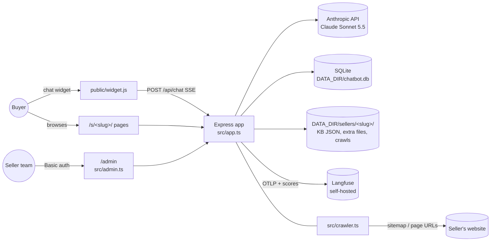
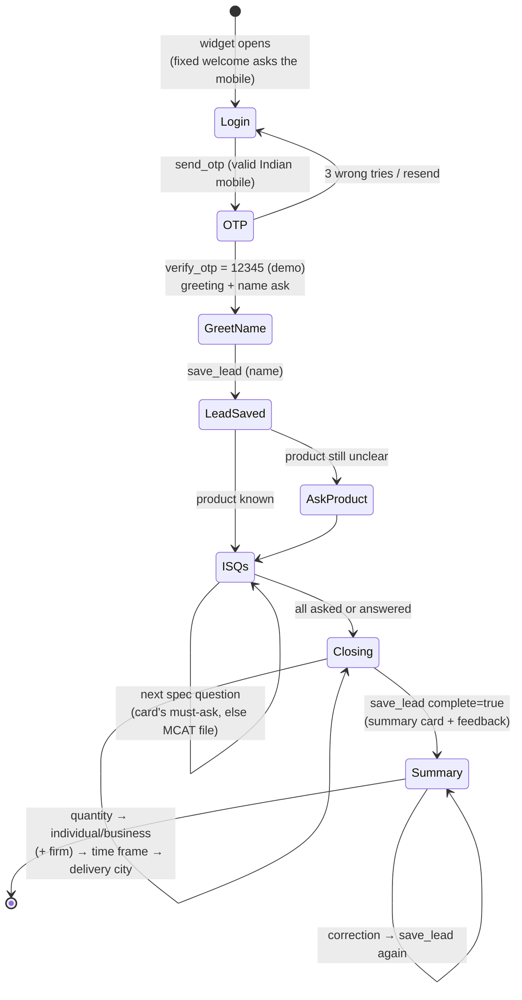
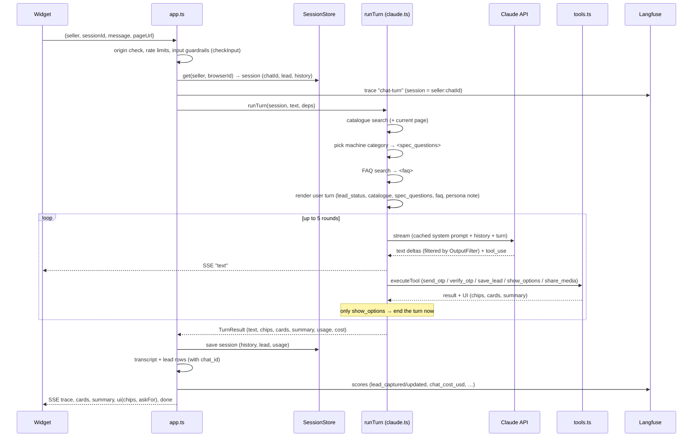

# Architecture

Seller assistants is one Node.js service that gives every B2B seller three things:

1. **An AI chat assistant** (embeddable widget) that answers buyers on the seller's behalf, captures a verified lead, and asks the right specification questions.
2. **A generated website** (`/s/<slug>/`): home, about, products, category, product, contact and search pages.
3. **An admin** (`/admin`) for the team: sellers, knowledge bases, extra files, prompts and their versions, the common FAQ, leads and transcripts, and Langfuse status.

Everything runs in a single Express process on a free Oracle Cloud server (Render before Nov 2026), with a SQLite database and seller files on its disk (`DATA_DIR`). The bot uses Claude (`claude-sonnet-5-5`, effort low) through the Anthropic SDK. Langfuse traces each buyer message when keys are set.

See [REPO_STRUCTURE.md](REPO_STRUCTURE.md) for the file tree.

---

## 1. System context



| Actor or system | Role |
|---|---|
| Buyer | Chats in the widget (on this platform's seller site, or embedded on the seller's own site) and browses the generated website. |
| Seller team | Uses `/admin` to add sellers, upload knowledge bases and files, edit prompts, and read leads and chats. |
| Anthropic API | Claude answers each buyer turn, streams text and calls tools. |
| SQLite | Chat sessions, transcripts, leads, guardrail events, prompts and versions. |
| Data disk | Uploaded KB JSON, extra seller files, the common FAQ, runtime crawls, admin-added sellers. |
| Langfuse | One trace per buyer message, grouped in one session per conversation, with scores. |

---

## 2. Buyer journey



- **Server-enforced rules:**
  - The OTP is checked on the server and never reaches the model.
  - `save_lead` is refused before verification.
  - Chips are refused while the buyer is typing the OTP or name.
- **Login first:** the enquiry can't go ahead without a verified number; the bot asks once more and explains why.
- **Closing steps** (`closingStep`, `mergeDetails` in `src/tools.ts`): quantity (in the card's selling unit), individual or business (buttons), the firm name for a business, time frame (buttons Immediately · Within 15 days · Within a month · 1–3 months · Just exploring), delivery city. Any answer counts, "not sure" included. They are kept on the lead as `details` and in the `leads` columns `buyer_type`, `firm_name`, `timeframe`.
- **Reply length:** 1–2 short sentences.
- **Feedback:** "Was this helpful? 👍 👎" appears once per chat, under the latest summary card.

---

## 3. One chat turn (`POST /api/chat`)



Key points:
- **Prompt caching:** the system prompt (seller KB, persona, guardrails) is identical across a seller's turns and cached. Anything that changes per turn goes into the user turn.
- **History stays valid without an extra call:** when a round only calls `show_options`, the turn ends without another Claude call, so the chips arrive at once. The buyer's next message is appended to the stored `tool_result` message (`withBuyerTurn`), which keeps the history valid.
- **Errors and refusals:** an API error or refusal gives a canned reply. A refused turn is not kept in history.

---

## 4. Knowledge: from files to the system prompt

```mermaid
flowchart TD
  subgraph Sources
    F[KB folder<br/>kb/sellers/&lt;slug&gt;/<br/>seller.json, business_card.json,<br/>product_cards.json, sitemap.xml, persona.json]
    J[Uploaded KB JSON<br/>seller export v5.0 (3.0 loads)]
    E1[Extra: business_card.md]
    E2[Extra: mcat_specifications.json]
    E3[Extra: product_cards.json]
    CR[Crawled pages<br/>catalogue.json]
  end
  J --> V[KbView<br/>src/sellerKb.ts]
  E2 --> V
  F --> FK[fileKb<br/>src/kb.ts]
  V --> K[compose()<br/>src/sellers.ts]
  FK --> K
  E1 --> K
  E3 --> K
  K --> KB[KnowledgeBase<br/>business card text, product cards text,<br/>allowed phones and domains]
  KB --> SP[renderSystemPrompt<br/>src/prompts.ts]
  P[prompts/system.md + guardrails.md<br/>or admin edits] --> SP
  PE[Brand persona] --> SP
  SP --> SYS[(cached system prompt per seller)]
  V --> CAT[Catalogue: KB JSON entries + crawl gaps<br/>src/catalogue.ts MiniSearch]
  CR --> CAT
```

- **Precedence:** an uploaded KB JSON is the main source. The extra files **merge** with it: the business card .md is appended, and uploaded product cards are added (for a KB-folder seller they replace the folder's cards). The MCAT file feeds the ISQs (below). Crawled pages only fill catalogue gaps.
- **Filtered out before the bot sees anything:** prices, delivery and payment terms, turnover, staff, year established, GST, bank and rating data (`cleanText`, `stripForbidden`, forbidden spec keys).
- **Large catalogues:** above about 300k characters (`PROMPT_BUDGET`), the prompt keeps categories, their ISQs and a product index. Product details come per message from the catalogue search (`promptPlan`: full, index or partial).

### Spec questions (ISQs)

The questions come from three files, in order (`planFor` in `src/cardQuestions.ts`, `KbView.isqPlan` in `src/sellerKb.ts`), up to 8 (`MAX_ISQS`), 6 options each:

```mermaid
flowchart LR
  P[Buyer's product<br/>category + MCAT] --> C{Product card<br/>with must-ask specs?}
  C -->|yes| CQ[1. The card's ASK attributes<br/>in ask_order; the card's values,<br/>else the MCAT file's, else the<br/>products'; under 2: in words]
  C -->|no| F{MCAT file entry<br/>by id, else equal name?}
  F -->|yes| FQ[2. The MCAT's specs, ISQ type<br/>order else file order; seller's<br/>values lead each spec's options]
  F -->|no| DQ[3. The products' own spec<br/>values (derived)]
```

- **Product cards** (`from: "card"`): each card's attributes carry a role; `ASK` (with `required_for_lead`) marks a must-ask spec, asked in `ask_order`. Label = the attribute key in words ("material_grade" → "Material grade"); the card's qualification question, when it has one, goes along as a phrasing hint. Options are the card's values with spellings merged; a spec with fewer than two gets the MCAT file's options for the same spec (`specNamesMatch`), then the values the seller's products list for it; still under two, it is an open question ("no buttons: ask in words"). RARE, DEFER and ON_REQUEST attributes are only answered if raised. The card's `selling_unit` phrases the quantity question.
- **MCAT file** (`from: "mcat"` / `"products"`): the product's MCAT entry (else one named like the category, else the category's main MCAT's), its specs in key → config → regular order when the file marks types, else the file's order; the seller's own values for a spec lead its options. Specs with fewer than two options are dropped.
- **Products** (`from: "derived"`): only when the MCAT file has no entry: attributes whose values differ across the category's products (`specStats`), most widely carried first.
- **Finding the card** (`CardIndex`, built per seller from the uploaded product cards with `mapCard`): the product the server picks is matched to the card naming its title, else the card mapped to the same category and MCAT, else the only card in that category. When the catalogue finds nothing, or the buyer's word names a different card the top hit's title lacks ("24 ghante ka cook chahiye" while the top hit is "24 Hours Maid Service"), the buyer's words pick the card: a word of its own name scores 3, of its categories 2, of a short alias 1; at least 2 wins and a tie picks none.
- **The server picks the product each turn** (`src/isqTracker.ts`): category, MCAT **and card** from, in order, the product or category page the buyer is on, the top catalogue match for the buyer's own words (or the card they name), or the product saved with the lead. A match from the buyer's words counts only when the message shares a distinctive word with it: a greeting or "price?" never picks a product. It sends only that product's questions as `<spec_questions>` ("Product: <card or category · MCAT> (from the product card's must-ask specs | from the MCAT specifications)"), marking which were asked and which comes next. An answer or a tapped chip never switches the product; naming another one does, and progress is kept when the questions stay the same. While the bot collects the firm name, time frame and city, only a message sharing two distinctive words with a product switches.
- **The server decides completion** (`notComplete` in `src/tools.ts`): `save_lead` with `complete: true` shows the summary card only when the product is known, every question of its plan was asked (buttons shown, `markAsked`) or answered (a `specs` label matching the question by name, `markAnswered`), and the closing steps are in. Otherwise the lead is still saved and the tool result names the next step (with its buttons), so the model asks it.
- **Knowledge mapping report** (`src/mapping.ts`, the Knowledge mapping card on the seller's page, `/admin/sellers/:slug/mapping.json`): per category its main MCAT, other MCATs, fallback question source and questions, with flags (MCAT id not in the file, no questions, derived); each product card's must-ask questions, with flags for cards without any and specs asked in words; MCAT file entries used/unused/missing; product cards mapped to a category and MCAT (by product, category, MCAT name, containing name or a distinctive word) or unmatched; product FAQ counts; policy card sections kept.

### FAQs

Two sources, one search per message (`FaqStore.forSeller` merges them; up to 3 hits go into the turn as `<faq>`):
- **The seller's own product FAQs** from the KB JSON (version 5.0 `products[].faqs`), tagged with the product name ("Q (about <product>): …").
- **The common sheet** `DATA_DIR/faq.xlsx` (or `.csv`): Question, Answer and optionally **Seller** (name, slug or IndiaMART seller id; "Exoticasteel" matches "Exotica Steel (India)") and **Category**. A row with a seller applies to that seller only; with a category, to sellers dealing in it; with neither, to all. `{seller_name}` is filled in.
- **Guardrails win:** rows and product FAQs whose answer states a price are dropped.

### Policy card (business card .md)

The seller's policy card (sections such as Business, Dispatch, Freight, GST, Packaging, Availability, Pricing basis, Sample policy, Warranty, Must escalate) is kept **whole as handling rules** under "Seller policy card (how to handle these topics)". Identity and financial facts (GSTIN, bank, turnover, staff, ratings, tenure) and the internal "Dropped" section are left out; money, percentages, delivery durations and payment-term sentences inside a rule are replaced by "[amount]" or removed. "Deals in" feeds the seller's terms; contact lines feed the numbers the bot may share.

---

## 5. Prompts and their versions

| Layer | Default (in git) | Edited in | Applies to |
|---|---|---|---|
| Common system prompt | `prompts/system.md` | `/admin/prompts` | every seller |
| Common guardrails (G1–G9) | `prompts/guardrails.md` | `/admin/prompts` | every seller (unless a seller has its own `guardrails.md`) |
| Brand persona: system part | `kb/sellers/<slug>/persona.json` | `/admin/sellers/<slug>/prompts` | that seller's system prompt |
| Brand persona: user part | same | same | every buyer turn, as `<seller_instructions>` |
| Per-turn template | `prompts/user.md` | — | every turn |

- **Version history:** every save, reset and restore, plus each shipped default, is a version in `prompt_versions` (View diff, Restore).
- **Built-ins apply themselves on deploy:** if a deploy changes a default file while an older admin edit of that part is in use, the new default replaces only the changed part (`applyNewerBuiltIn`, `applyNewerBuiltInPersonas`). The old edit stays in the history.

---

## 6. Guardrails

| Layer | Where | What |
|---|---|---|
| Input | `checkInput` (`src/guardrails.ts`) | Length limits; payment, UPI, GSTIN and ID details are redacted before the bot or the transcript see them. |
| Prompt | `prompts/guardrails.md` + system prompt | The nine rules (G1 price … G9 other products) and the "sources only" rule. |
| Output | `OutputFilter` (`src/guardrails.ts`) | Streams through a sentence filter that replaces prices, freight terms, unknown contacts and links, stock and authenticity claims, delivery dates and GST statements with a hand-off line; the model is told next turn (`<operator_note>`). |
| Tools | `src/tools.ts` | OTP and lead order enforced on the server; the OTP never reaches the model. |
| Data | `src/sellerKb.ts`, `src/sellerFiles.ts`, `src/crawler.ts` | Forbidden data is never put into the prompt. |

---

## 7. Observability (Langfuse)

- **Grouping:** one trace (`chat-turn`) per buyer message. Its **session** is `<seller>:<chatId>`, unique per conversation (a new chat after 2 hours idle or **New chat** gets a new one).
- **Attributes:** every span is stamped with `session.id`/`user.id` and the legacy `langfuse.session.id`/`langfuse.user.id` (`SessionStampProcessor`).
- **Observations:**
  - `catalogue-search`, `faq-search` (retriever)
  - `claude round N` (generation: served model, tokens, cost)
  - each tool call
  - `output-guardrails`
- **Scores:**
  - `lead_captured`, `lead_updated`, `summary_shown`, `guardrail_fired`, `fallback_reply`
  - `chat_cost_usd` (per session, running total)
  - `buyer_feedback` / `chat_feedback`
- **Privacy:** mobiles are masked (`xxxxxx3210`) everywhere, OTPs are never recorded, and the system prompt is referenced by version, not copied.
- **Health:** the startup key check (with EU/US region detection), upload counters, the server version, `/health`, and **Test Langfuse** on `/admin`.

---

## 8. Data model (SQLite, `DATA_DIR/chatbot.db`)

| Table | Holds | Key columns |
|---|---|---|
| `sessions` | Live chat state | `id` (`<seller>:<browserId>`), `chat_id`, messages, lead (JSON: stage, mobile, name, category, asked ISQs), seen catalogue, usage (tokens, cost) |
| `transcript` | What buyers typed (redacted) and what they saw | `session_id`, `chat_id`, role, text, guardrails, `trace_id` |
| `leads` | Verified enquiries | seller, `session_id`, `chat_id`, mobile, name, product, requirements, quantity, `buyer_type`, `firm_name`, `timeframe`, city (delivery), page_url, `test` (1 = from a Test key of the bot API, hidden on the Leads page by default), `buyer_id` (the buyer's id on the platform that opened the chat) |
| `guardrail_events` | Output-filter replacements | seller, session, rule, original |
| `platform_prompts` | Admin edits of the common system prompt and guardrails | key, value, updated_at |
| `seller_prompts` | Admin-saved brand personas | seller, system, user |
| `prompt_versions` | History of all of the above plus shipped defaults | scope (`common` / `seller:<slug>`), a, b, source, note |
| `bot_keys` | Bot API keys | seller, `key_hash` (sha256; the key itself is shown once), prefix, label, `kind` (`live` = real leads, `test` = test leads and `eval` traces), created / last used / revoked |

Files on the data disk:
- `sellers/<slug>/seller_kb.json` (uploaded KB JSON)
- `sellers/<slug>/files/` (extra files)
- `sellers/<slug>/catalogue.json` (runtime crawl)
- `sellers/<slug>/seller.json` (admin-added sellers)
- `faq.xlsx` / `faq.csv`

---

## 9. HTTP surface

| Area | Routes |
|---|---|
| Health | `GET /health` (build commit and start time, sellers, model, tracing status) |
| Chat API | `GET /api/sellers/:seller` (widget settings, fixed intro) · `POST /api/chat` (SSE) · `POST /api/feedback` |
| Bot API (`X-Bot-Key`, any origin; see [BOT_API.md](BOT_API.md), Auditor notes in [SIMULATOR_API.md](SIMULATOR_API.md)) | `GET /api/v1/bots/:slug` (name, welcome, seller id, demo OTP, key kind) · `POST /api/v1/bots/:slug/conversations` (opens a chat with the buyer's name, mobile, `mobileVerified`, `buyerId`, `sellerId` check; the bot skips what it is given) · `POST /api/v1/bots/:slug/chat` (one JSON reply per message; a Live key saves real leads and tags traces `api`, a Test key saves test leads and tags `eval`) |
| Website | `GET /` (directory, visit-only) · `/s/:seller/` · `/about` · `/products` · `/contact` · `/c/:slug` · `/p/:slug` · `/search` |
| Admin (Basic auth, same-origin POSTs) | `/admin` (sellers list, tracing status) · `/admin/sellers/new` · `/admin/sellers/:seller` (one seller's page: knowledge base, extra files, mapping, catalogue, keys, persona, delete) · `/admin/sellers/:seller/kb` (+ `.json`, delete) · `/admin/sellers/:seller/files/:kind` (+ delete) · `/admin/sellers/:seller/view/:kind` (`kb`, `business-card`, `mcat`, `product-cards`: the stored file inline, `no-store`, `?download=1`) · `/admin/sellers/:seller/recrawl` · `/admin/sellers/:seller/prompts` · `/admin/sellers/:seller/keys` (+ `/:id/revoke`) · `/admin/prompts` · `/admin/prompts/versions/:id` (+ restore) · `/admin/faq` (+ download, delete) · `/admin/tracing/test` · `/admin/backup` (zip of the data disk) · `/admin/backup/restore` (staged, applied on restart) · `/admin/leads` (+ `.csv`) · `/admin/transcript/:sessionId` |
| Static | `public/` (widget.js, site.css, admin.css, demo.html) |

---

## 10. Deployment and configuration

- **Oracle Cloud Always Free** (`deploy/oracle/`, guide in `docs/DEPLOY_ORACLE.md`): Ubuntu 24.04 ARM, Node 22 behind Caddy (HTTPS), data at `/var/data` (`DATA_DIR`). A systemd timer deploys `main` within 2 minutes: each commit is built in its own release folder, switched to and checked on `/health`, with a rollback on failure. A nightly timer saves the backup zip.
- **Backup and restore** (`src/backup.ts`, `/admin` Backup card): `GET /admin/backup` zips a consistent copy of the database (SQLite online backup) plus every file under `DATA_DIR`. `POST /admin/backup/restore` checks a zip and stages it in `DATA_DIR/.restore-pending`, then the server exits. On the next start, `applyPendingRestore` swaps it in before anything opens the data and keeps the old data in `.before-restore-<time>`.
- **Render** (`render.yaml`): the paid alternative, a Node 22 web service with a 1 GB disk at `/var/data`.
- **Start:** `npm run build` (tsc), then `node dist/src/server.js`.
- **Startup** (`src/server.ts`):
  1. Load sellers (KB folders + admin sellers + uploads + extra files).
  2. Open the DB.
  3. Start tracing (key check).
  4. Load the FAQ.
  5. Create the app: apply DB prompts and personas, record versions, auto-apply new built-ins.
  6. Listen, crawl if configured, prune idle sessions daily.
- **Key environment variables:**
  - `ANTHROPIC_API_KEY`, `BOT_MODEL`, `BOT_EFFORT`, `BOT_FALLBACKS`
  - `ADMIN_PASSWORD`, `DATA_DIR`, `ALLOWED_ORIGINS`
  - `LANGFUSE_PUBLIC_KEY`, `LANGFUSE_SECRET_KEY`, `LANGFUSE_BASE_URL`, `LANGFUSE_ENVIRONMENT`
  - `CRAWL_ON_START`, `CRAWL_INTERVAL_HOURS`, `DEMO_OTP`
- **Graceful shutdown:** flushes traces and closes the DB.

---

## 11. Extension points

| To… | Change |
|---|---|
| Send real OTPs | Replace the demo check in `send_otp` / `verify_otp` (`src/tools.ts`) and stop sending `demo: true` (`/api/sellers/:seller`). |
| Add a tool | Its definition and zod schema in `src/tools.ts`, its handling in `runTurn` (`src/claude.ts`), any UI in `public/widget.js`. |
| Change the journey or style | `prompts/system.md` (it applies itself on deploy). |
| Add a seller | Upload its KB JSON with **+ Add seller** on `/admin`, or commit a KB folder under `kb/sellers/<slug>/`. |
| Tune ISQs | `cardQuestions` / `CardIndex` / `planFor` (`src/cardQuestions.ts`) for card questions; `isqPlan` / `fileQuestions` / `deriveIsqs` (`src/sellerKb.ts`) for the fallbacks; fix the product cards, MCAT file or product specs the mapping report flags. |
| Change the catalogue search or the product pick | `Catalogue.search` (`src/catalogue.ts`), `updateCategory` (`src/isqTracker.ts`); then `npm run retrieval:eval` against the sellers' test cases and compare with the recorded baseline. |
| Add a guardrail check | `OutputFilter` rules in `src/guardrails.ts`, plus the text in `prompts/guardrails.md`. |
