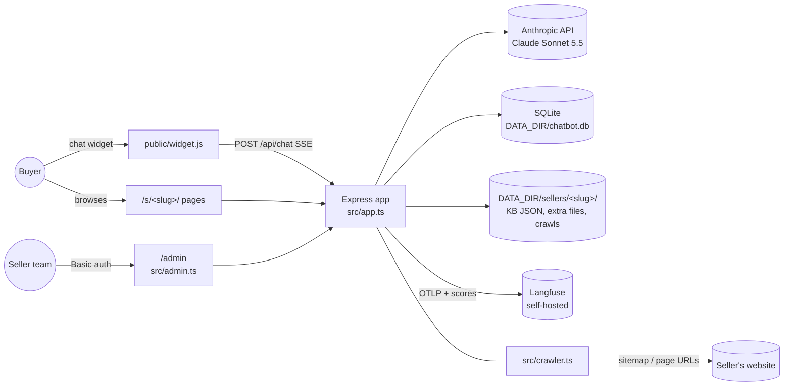
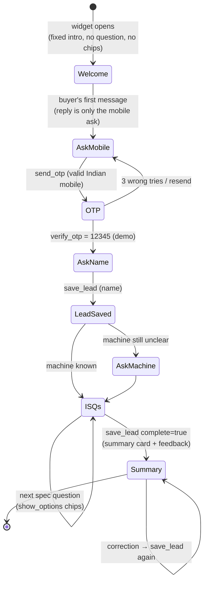
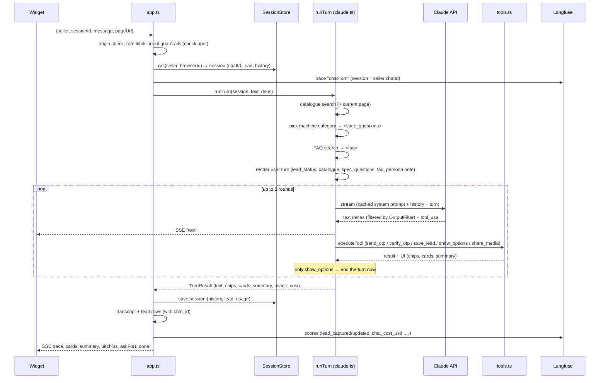
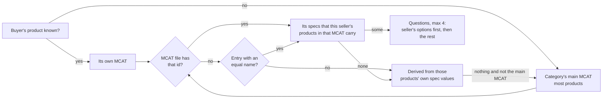

# Architecture

Seller assistants is one Node.js service that gives every B2B seller three things:

1. **An AI chat assistant** (embeddable widget) that answers buyers on the seller's behalf, captures a verified lead, and asks the right specification questions.
2. **A generated website** (`/s/<slug>/`): home, about, products, category, product, contact and search pages.
3. **An admin** (`/admin`) for the team: sellers, knowledge bases, extra files, prompts and their versions, the common FAQ, leads and transcripts, and Langfuse status.

Everything runs in a single Express process on Render, with a SQLite database and seller files on a persistent disk. The bot uses Claude (`claude-sonnet-5-5`, effort low) through the Anthropic SDK. Langfuse traces each buyer message when keys are set.

See [REPO_STRUCTURE.md](REPO_STRUCTURE.md) for the file tree.

---

## 1. System context



| Actor or system | Role |
|---|---|
| Buyer | Chats in the widget (on this platform's seller site, or embedded on the seller's own site) and browses the generated website. |
| Seller team | Uses `/admin` to add sellers, upload knowledge bases and files, edit prompts, and read leads and chats. |
| Anthropic API | Claude answers each buyer turn, streams text and calls tools. |
| SQLite | Chat sessions, transcripts, leads, guardrail events, prompts and versions. |
| Data disk | Uploaded KB JSON, extra seller files, the common FAQ, runtime crawls, admin-added sellers. |
| Langfuse | One trace per buyer message, grouped in one session per conversation, with scores. |

---

## 2. Buyer journey



- **Server-enforced rules:**
  - The OTP is checked on the server and never reaches the model.
  - `save_lead` is refused before verification.
  - Chips are refused while the buyer is typing the OTP or name.
- **Buyer who won't share a number:** isn't blocked. The bot offers again once, when they ask about a price, quote or callback.
- **Reply length:** 1–2 short sentences.
- **Feedback:** "Was this helpful? 👍 👎" appears once per chat, under the latest summary card.

---

## 3. One chat turn (`POST /api/chat`)



Key points:
- **Prompt caching:** the system prompt (seller KB, persona, guardrails) is identical across a seller's turns and cached. Anything that changes per turn goes into the user turn.
- **History stays valid without an extra call:** when a round only calls `show_options`, the turn ends without another Claude call, so the chips arrive at once. The buyer's next message is appended to the stored `tool_result` message (`withBuyerTurn`), which keeps the history valid.
- **Errors and refusals:** an API error or refusal gives a canned reply. A refused turn is not kept in history.

---

## 4. Knowledge: from files to the system prompt

```mermaid
flowchart TD
  subgraph Sources
    F[KB folder<br/>kb/sellers/&lt;slug&gt;/<br/>seller.json, business_card.json,<br/>product_cards.json, sitemap.xml, persona.json]
    J[Uploaded KB JSON<br/>seller export v3.0]
    E1[Extra: business_card.md]
    E2[Extra: mcat_specifications.json]
    E3[Extra: product_cards.json]
    CR[Crawled pages<br/>catalogue.json]
  end
  J --> V[KbView<br/>src/sellerKb.ts]
  E2 --> V
  F --> FK[fileKb<br/>src/kb.ts]
  V --> K[compose()<br/>src/sellers.ts]
  FK --> K
  E1 --> K
  E3 --> K
  K --> KB[KnowledgeBase<br/>business card text, product cards text,<br/>allowed phones and domains]
  KB --> SP[renderSystemPrompt<br/>src/prompts.ts]
  P[prompts/system.md + guardrails.md<br/>or admin edits] --> SP
  PE[Brand persona] --> SP
  SP --> SYS[(cached system prompt per seller)]
  V --> CAT[Catalogue: KB JSON entries + crawl gaps<br/>src/catalogue.ts MiniSearch]
  CR --> CAT
```

- **Precedence:** an uploaded KB JSON is the main source. The extra files **merge** with it: the business card .md is appended, and uploaded product cards are added (for a KB-folder seller they replace the folder's cards). The MCAT file feeds the ISQs (below). Crawled pages only fill catalogue gaps.
- **Filtered out before the bot sees anything:** prices, delivery and payment terms, turnover, staff, year established, GST, bank and rating data (`cleanText`, `stripForbidden`, forbidden spec keys).
- **Large catalogues:** above about 300k characters (`PROMPT_BUDGET`), the prompt keeps categories, their ISQs and a product index. Product details come per message from the catalogue search (`promptPlan`: full, index or partial).

### Spec questions (ISQs)

A site category usually pools several MCATs (IndiaMART micro-categories): "GSP Triply Cookware" holds kadhais, topes and handis. Every product carries its MCAT in `taxonomy.glmcat_ids`, and the seller's MCAT specifications file is generated for those ids. So the questions are chosen per **MCAT within a category**, and checked against what the seller actually sells:



- **Present on products:** an MCAT spec is asked only when a product of that MCAT has a spec of the same name (`specNamesMatch`: equal once normalised, or one name's words all in the other, so "Size/Diameter" covers "Diameter").
- **Options:** all of the MCAT's options (max 6), the ones matching a product value first ("22 Gauge" before "18 Gauge" when the seller only makes 22).
- **Derived fallback** (`deriveIsqs`): brand, model, usage and machine type skipped, spellings merged, bare numbers dropped, attribute on ≥25% of the products, up to 4 questions with 6 options.
- **The server picks the machine each turn** (`src/isqTracker.ts`): category **and MCAT** from, in order, the product or category page the buyer is on, the top catalogue match for the buyer's own words, or the product saved with the lead. It sends only that machine's questions as `<spec_questions>` ("Machine: <category> · <MCAT>"), marking which were asked and which comes next. An answer or a tapped chip never switches the machine; naming another machine does, and progress is kept when the questions stay the same.
- **Knowledge mapping report** (`src/mapping.ts`, Manage → Knowledge mapping, `/admin/sellers/:slug/mapping.json`): per category its main MCAT, other MCATs, question source and questions, with flags (MCAT id not in the file, no questions, derived); MCAT file entries used/unused/missing; product cards mapped to a category and MCAT (by product, category, MCAT name, containing name or a distinctive word) or unmatched; product FAQ counts; policy card sections kept.

### FAQs

Two sources, one search per message (`FaqStore.forSeller` merges them; up to 3 hits go into the turn as `<faq>`):
- **The seller's own product FAQs** from the KB JSON (version 5.0 `products[].faqs`), tagged with the product name ("Q (about <product>): …").
- **The common sheet** `DATA_DIR/faq.xlsx` (or `.csv`): Question, Answer and optionally **Seller** (name, slug or IndiaMART seller id; "Exoticasteel" matches "Exotica Steel (India)") and **Category**. A row with a seller applies to that seller only; with a category, to sellers dealing in it; with neither, to all. `{seller_name}` is filled in.
- **Guardrails win:** rows and product FAQs whose answer states a price are dropped.

### Policy card (business card .md)

The seller's policy card (sections such as Business, Dispatch, Freight, GST, Packaging, Availability, Pricing basis, Sample policy, Warranty, Must escalate) is kept **whole as handling rules** under "Seller policy card (how to handle these topics)". Identity and financial facts (GSTIN, bank, turnover, staff, ratings, tenure) and the internal "Dropped" section are left out; money, percentages, delivery durations and payment-term sentences inside a rule are replaced by "[amount]" or removed. "Deals in" feeds the seller's terms; contact lines feed the numbers the bot may share.

---

## 5. Prompts and their versions

| Layer | Default (in git) | Edited in | Applies to |
|---|---|---|---|
| Common system prompt | `prompts/system.md` | `/admin/prompts` | every seller |
| Common guardrails (G1–G9) | `prompts/guardrails.md` | `/admin/prompts` | every seller (unless a seller has its own `guardrails.md`) |
| Brand persona: system part | `kb/sellers/<slug>/persona.json` | `/admin/sellers/<slug>/prompts` | that seller's system prompt |
| Brand persona: user part | same | same | every buyer turn, as `<seller_instructions>` |
| Per-turn template | `prompts/user.md` | — | every turn |

- **Version history:** every save, reset and restore, plus each shipped default, is a version in `prompt_versions` (View diff, Restore).
- **Built-ins apply themselves on deploy:** if a deploy changes a default file while an older admin edit of that part is in use, the new default replaces only the changed part (`applyNewerBuiltIn`, `applyNewerBuiltInPersonas`). The old edit stays in the history.

---

## 6. Guardrails

| Layer | Where | What |
|---|---|---|
| Input | `checkInput` (`src/guardrails.ts`) | Length limits; payment, UPI, GSTIN and ID details are redacted before the bot or the transcript see them. |
| Prompt | `prompts/guardrails.md` + system prompt | The nine rules (G1 price … G9 other products) and the "sources only" rule. |
| Output | `OutputFilter` (`src/guardrails.ts`) | Streams through a sentence filter that replaces prices, freight terms, unknown contacts and links, stock and authenticity claims, delivery dates and GST statements with a hand-off line; the model is told next turn (`<operator_note>`). |
| Tools | `src/tools.ts` | OTP and lead order enforced on the server; the OTP never reaches the model. |
| Data | `src/sellerKb.ts`, `src/sellerFiles.ts`, `src/crawler.ts` | Forbidden data is never put into the prompt. |

---

## 7. Observability (Langfuse)

- **Grouping:** one trace (`chat-turn`) per buyer message. Its **session** is `<seller>:<chatId>`, unique per conversation (a new chat after 2 hours idle or **New chat** gets a new one).
- **Attributes:** every span is stamped with `session.id`/`user.id` and the legacy `langfuse.session.id`/`langfuse.user.id` (`SessionStampProcessor`).
- **Observations:**
  - `catalogue-search`, `faq-search` (retriever)
  - `claude round N` (generation: served model, tokens, cost)
  - each tool call
  - `output-guardrails`
- **Scores:**
  - `lead_captured`, `lead_updated`, `summary_shown`, `guardrail_fired`, `fallback_reply`
  - `chat_cost_usd` (per session, running total)
  - `buyer_feedback` / `chat_feedback`
- **Privacy:** mobiles are masked (`xxxxxx3210`) everywhere, OTPs are never recorded, and the system prompt is referenced by version, not copied.
- **Health:** the startup key check (with EU/US region detection), upload counters, the server version, `/health`, and **Test Langfuse** on `/admin`.

---

## 8. Data model (SQLite, `DATA_DIR/chatbot.db`)

| Table | Holds | Key columns |
|---|---|---|
| `sessions` | Live chat state | `id` (`<seller>:<browserId>`), `chat_id`, messages, lead (JSON: stage, mobile, name, category, asked ISQs), seen catalogue, usage (tokens, cost) |
| `transcript` | What buyers typed (redacted) and what they saw | `session_id`, `chat_id`, role, text, guardrails, `trace_id` |
| `leads` | Verified enquiries | seller, `session_id`, `chat_id`, mobile, name, product, requirements, quantity, city, page_url, `test` (1 = from the simulator API, hidden on the Leads page by default) |
| `guardrail_events` | Output-filter replacements | seller, session, rule, original |
| `platform_prompts` | Admin edits of the common system prompt and guardrails | key, value, updated_at |
| `seller_prompts` | Admin-saved brand personas | seller, system, user |
| `prompt_versions` | History of all of the above plus shipped defaults | scope (`common` / `seller:<slug>`), a, b, source, note |
| `bot_keys` | Simulator API keys | seller, `key_hash` (sha256; the key itself is shown once), prefix, label, created / last used / revoked |

Files on the data disk:
- `sellers/<slug>/seller_kb.json` (uploaded KB JSON)
- `sellers/<slug>/files/` (extra files)
- `sellers/<slug>/catalogue.json` (runtime crawl)
- `sellers/<slug>/seller.json` (admin-added sellers)
- `faq.xlsx` / `faq.csv`

---

## 9. HTTP surface

| Area | Routes |
|---|---|
| Health | `GET /health` (build commit and start time, sellers, model, tracing status) |
| Chat API | `GET /api/sellers/:seller` (widget settings, fixed intro) · `POST /api/chat` (SSE) · `POST /api/feedback` |
| Simulator API (`X-Bot-Key`, any origin; see [SIMULATOR_API.md](SIMULATOR_API.md)) | `GET /api/v1/bots/:slug` (name, welcome, demo OTP) · `POST /api/v1/bots/:slug/chat` (one JSON reply per message; chat saved as test, traces tagged `eval`) |
| Website | `GET /` (directory, visit-only) · `/s/:seller/` · `/about` · `/products` · `/contact` · `/c/:slug` · `/p/:slug` · `/search` |
| Admin (Basic auth, same-origin POSTs) | `/admin` (seller rows, tracing test) · `/admin/sellers/new` · `/admin/sellers/:seller/kb` (+ `.json`, delete) · `/admin/sellers/:seller/files/:kind` (+ delete) · `/admin/sellers/:seller/recrawl` · `/admin/sellers/:seller/prompts` · `/admin/sellers/:seller/keys` (+ `/:id/revoke`) · `/admin/prompts` · `/admin/prompts/versions/:id` (+ restore) · `/admin/faq` (+ download, delete) · `/admin/tracing/test` · `/admin/leads` (+ `.csv`) · `/admin/transcript/:sessionId` |
| Static | `public/` (widget.js, site.css, admin.css, demo.html) |

---

## 10. Deployment and configuration

- **Render** (`render.yaml`): Node 22 web service with a 1 GB disk at `/var/data` (`DATA_DIR`). It auto-deploys `main`.
- **Start:** `npm run build` (tsc), then `node dist/src/server.js`.
- **Startup** (`src/server.ts`):
  1. Load sellers (KB folders + admin sellers + uploads + extra files).
  2. Open the DB.
  3. Start tracing (key check).
  4. Load the FAQ.
  5. Create the app: apply DB prompts and personas, record versions, auto-apply new built-ins.
  6. Listen, crawl if configured, prune idle sessions daily.
- **Key environment variables:**
  - `ANTHROPIC_API_KEY`, `BOT_MODEL`, `BOT_EFFORT`, `BOT_FALLBACKS`
  - `ADMIN_PASSWORD`, `DATA_DIR`, `ALLOWED_ORIGINS`
  - `LANGFUSE_PUBLIC_KEY`, `LANGFUSE_SECRET_KEY`, `LANGFUSE_BASE_URL`, `LANGFUSE_ENVIRONMENT`
  - `CRAWL_ON_START`, `CRAWL_INTERVAL_HOURS`, `DEMO_OTP`
- **Graceful shutdown:** flushes traces and closes the DB.

---

## 11. Extension points

| To… | Change |
|---|---|
| Send real OTPs | Replace the demo check in `send_otp` / `verify_otp` (`src/tools.ts`) and stop sending `demo: true` (`/api/sellers/:seller`). |
| Add a tool | Its definition and zod schema in `src/tools.ts`, its handling in `runTurn` (`src/claude.ts`), any UI in `public/widget.js`. |
| Change the journey or style | `prompts/system.md` (it applies itself on deploy). |
| Add a seller | Upload its KB JSON with **+ Add seller** on `/admin`, or commit a KB folder under `kb/sellers/<slug>/`. |
| Tune ISQs | `isqPlan` / `presentSpecs` / `deriveIsqs` (`src/sellerKb.ts`); fix the MCAT file or product specs the mapping report flags. |
| Add a guardrail check | `OutputFilter` rules in `src/guardrails.ts`, plus the text in `prompts/guardrails.md`. |
